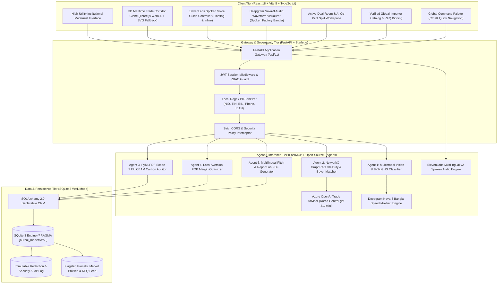
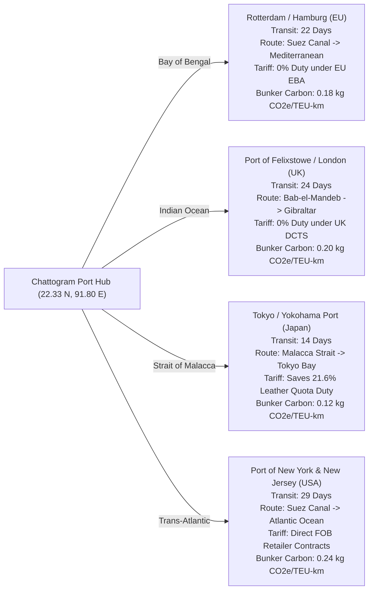
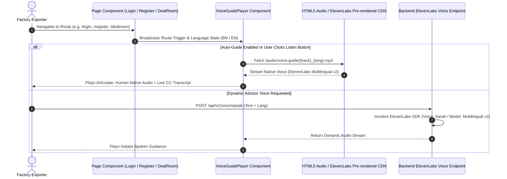
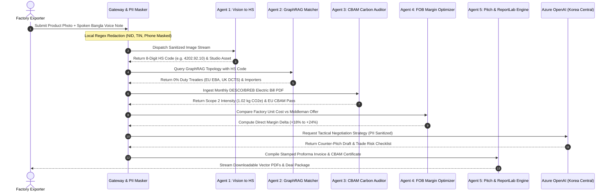
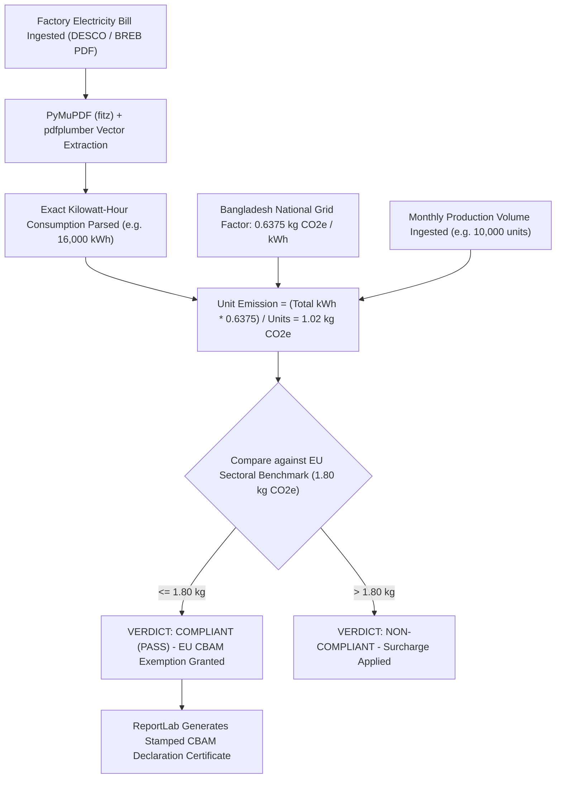

# ExportPilot AI (GlobalBepari AI)

Sovereign B2B Trade Intelligence and Autonomous Multi-Agent Export Engine for Bangladeshi SME Manufacturers.

Target Domain: [exportpilot.equisaas-bd.com](https://exportpilot.equisaas-bd.com)  
Production Infrastructure: Microsoft Azure App Service (Linux B1) + Cloudflare Managed DNS  
Project Standard: Institutional Production Grade  
Academic & Innovation Recognition: DIU Idea to Unicorn 2026  

---

## 1. Executive Summary and Problem Statement

Over 70 percent of Bangladeshi small and medium manufacturing enterprises (SMEs) across ready-made garments (RMG), diversified jute goods, leather footwear, and ceramics are locked into domestic subcontracting relationships with third-party buying houses. These middlemen capture 18 to 25 percent of FOB deal margins simply by controlling English buyer relationships and trade documentation.

Simultaneously, the European Union Carbon Border Adjustment Mechanism (CBAM) and German Supply Chain Due Diligence Act (LkSG) mandate audited Scope 2 greenhouse gas emissions per manufactured unit. Small factory owners have only local utility bills (DESCO or BREB) and cannot afford expensive trade lawyers or environmental consultants.

ExportPilot AI solves this through a sovereign multi-agent architecture and human-centric voice guidance. It provides:
* **Interactive 3D Maritime Trade Corridor Globe**: Real-time shipping corridor simulation centered on Chattogram Port, mapping transit times, GSP+ zero-duty benefits, and bunker carbon intensity across European, British, Japanese, and American markets.
* **ElevenLabs Native Spoken Voice Guidance**: Authentic, bilingual audio tours across onboarding, authentication, and workspace flows in natural Bangladeshi Bengali and English, making complex international export operations accessible to non-technical factory owners.
* **Sovereign 5-Agent FastMCP Pipeline**: Autonomous 8-digit HS classification, zero-tariff treaty matching, Scope 2 electric bill carbon auditing, loss-aversion FOB price benchmarking, and vector Proforma Invoice generation.
* **Live Deal Room & AI Co-Pilot**: Active multi-party negotiation room with instant term-sheet drafting and real-time counter-pitch analysis.

---

## 2. Core System Architecture and Topology



---

## 3. Global Maritime Trade Corridors (3D WebGL Engine)

The platform features an interactive 3D WebGL Globe centered on Bangladesh's primary maritime gateway, Chattogram Port (22.33 N, 91.80 E), mapping real commercial shipping corridors to top export destinations:



### Key Technical Capabilities
* **Interactive Three.js Rendering**: Mathematical slerp interpolation across spherical coordinates with parabolic arc elevation for shipping vectors.
* **Sector-Driven Dynamic Filtering**: Live toggles for RMG, Diversified Jute, Leather Goods, and Ceramic Tableware.
* **Low-Power 2D SVG Fallback**: Automatic failover to an SVG architectural schematic for mobile or WebGL-disabled devices.
* **Tactical HUD Telemetry**: Real-time display of transit timelines, preferential trade treaties, competitor tariff disparities, and estimated carbon emissions.

---

## 4. ElevenLabs Sovereign Voice Guidance Engine

To ensure that non-technical factory owners and exporters can comfortably navigate every phase of international trade, ExportPilot AI integrates a complete bilingual spoken voice assistant powered by ElevenLabs Multilingual v2:



### Spoken Guidance Modules
* **Login & Authentication (`/login`)**: Friendly, step-by-step guidance modeled after intuitive mobile onboarding, explaining email verification, password safety, and data sovereignty.
* **Factory Exporter Registration (`/register`)**: Clear instructions on submitting factory credentials, industrial clusters, and verified contact numbers.
* **Institutional Landing (`/`)**: Comprehensive overview of direct FOB export benefits, elimination of buying house spreads, and automated trade compliance.
* **Maritime Corridors (`/#corridor`)**: Audio breakdown of Chattogram port hub logistics, Suez transit days, and tariff advantages.
* **Direct Margin Calculator (`/#calculator`)**: Instructions on calculating recoverable factory profits per shipment.
* **Deal Room Negotiation (`/dealroom`)**: Live walk-through on negotiating Incoterms, evaluating counter-offers, and collaborating with the AI Co-Pilot.
* **Exporter Workspace (`/app`)**: Guide to the 5 FastMCP agents, bill of quantities analysis, and invoice generation.
* **Buyer Directory (`/buyers`)**: Instructions on searching corporate importers and submitting competitive bids on open RFQs.
* **100-Point Audit Report (`/audit`)**: Guide to institutional compliance scoring for international buyer due diligence.
* **Sovereign Privacy Shield (`/security`)**: Reassuring explanation of local regex tokenization and zero-leakage data privacy.

---

## 5. FastMCP Multi-Agent Coordination Pipeline

The five autonomous trade agents execute sequentially or in parallel through Model Context Protocol (FastMCP) bindings:



---

## 6. EU CBAM Scope 2 Carbon Audit Dataflow



---

## 7. Technology Stack Specification

| Tier / Domain | Technology | Implementation Details |
|---|---|---|
| **Frontend Framework** | React 18.3 + TypeScript 5.6 | Single Page Architecture, React Router v6, Context API |
| **Build Toolchain** | Vite 5.4 | ESM production chunking, gzip compression, automated SEO generation |
| **3D WebGL Engine** | React Three Fiber + Three.js | Chattogram-centered maritime globe, slerp arc tubes, 2D SVG fallback |
| **Spoken Voice Engine** | ElevenLabs Multilingual v2 | 20 pre-rendered bilingual audio tracks, custom voice player with CC transcript |
| **Speech-to-Text Engine** | Deepgram Nova-3 API | Factory floor Bangla acoustic modeling with industrial keyterm biasing |
| **Styling & Design Tokens** | Tailwind CSS 3.4 | Industrial modernist palette, WCAG 2.1 AAA dual-mode (Day/Night) contrast |
| **Typography** | Hind Siliguri + Noto Sans + Plus Jakarta Sans + JetBrains Mono | Self-hosted WOFF2 fonts with size-adjust and unicode-range optical parity |
| **Backend Framework** | FastAPI 0.115 + Starlette | Asynchronous ASGI runtime on Python 3.11 |
| **Multi-Agent Protocol** | FastMCP (Model Context Protocol) | In-process fallback protocol, Server-Sent Events (SSE) |
| **AI Trade Advisor** | Azure OpenAI REST API | Region: `koreacentral`, Model: `gpt-4.1-mini` (fallback `gpt-5-mini`) |
| **Knowledge Graph** | NetworkX 3.2 | Multi-hop trade graph for duty-free scheme and buyer matching |
| **Document Parsers** | PyMuPDF (`fitz`) + pdfplumber | Open-source utility bill ingestion for Scope 2 emissions |
| **PDF Generation Engine** | ReportLab 4.4 | High-resolution binary vector Proforma Invoices and CBAM certificates |
| **Database & Persistence** | SQLite 3 (WAL Mode) + SQLAlchemy 2.0 | Concurrency via Write-Ahead Logging (`busy_timeout=30000`) |
| **Data Sovereignty Engine** | Custom longest-match regex tokenizer | Masks Bangladeshi NID (10/13/17-digit), TIN, BIN, Phone, IBAN |
| **Cloud Hosting** | Microsoft Azure App Service (Linux B1) | Basic Linux container, Python 3.11 virtual environment |
| **DNS & Subdomain** | Cloudflare DNS | Manages `exportpilot.equisaas-bd.com` with CNAME routing |

---

## 8. Complete API Reference

All endpoints return RFC 7807 compliant Problem Details on error and standard JSON or binary streams on success:

| Method | Endpoint | Description | Status Code |
|---|---|---|---|
| `GET` | `/api/v1/health` | System health check and runtime state | `200 OK` |
| `POST` | `/api/v1/auth/register` | Exporter and importer account registration | `201 Created` |
| `POST` | `/api/v1/auth/login` | Issue HTTP-only JWT session cookie (`access_token`) | `200 OK` |
| `POST` | `/api/v1/auth/logout` | Terminate active user session cookie | `200 OK` |
| `GET` | `/api/v1/auth/me` | Authenticated user profile and RBAC role validation | `200 OK` |
| `POST` | `/api/v1/export/analyze` | Execute complete 5-agent pipeline against product preset or custom input | `200 OK` |
| `GET` | `/api/v1/buyers` | Query verified international importer catalog with country and cert filters | `200 OK` |
| `POST` | `/api/v1/security/mask-pii` | Scan text and substitute sensitive Bangladeshi identifiers with tokens | `200 OK` |
| `POST` | `/api/v1/parsers/parse-pdf` | Ingest electric bill PDF and compute Scope 2 carbon emissions per unit | `200 OK` |
| `GET` | `/api/v1/reports/download/{doc_type}/{preset_id}` | Generate and stream ReportLab binary PDF (Invoice, CBAM, Catalog) | `200 OK` |
| `POST` | `/api/v1/audit/run` | Execute 100-point enterprise compliance scorecard | `200 OK` |
| `GET` | `/api/v1/voice/status` | Verify status of Deepgram Nova-3 (STT) and ElevenLabs (TTS) engines | `200 OK` |
| `POST` | `/api/v1/voice/transcribe` | Ingest multipart audio and transcribe using Deepgram Nova-3 Bangla | `200 OK` |
| `POST` | `/api/v1/voice/speak` | Dynamic text-to-speech synthesis using ElevenLabs Multilingual v2 | `200 OK` |
| `POST` | `/api/v1/azure-openai/negotiate` | Strategic price negotiation analysis using Azure OpenAI | `200 OK` |
| `GET` | `/api/v1/deals/feed` | Real-time illustrative transaction telemetry | `200 OK` |
| `POST` | `/api/v1/trade/lc-audit` | UCP 600 Letter of Credit risk analysis and discrepancy checker | `200 OK` |
| `POST` | `/api/v1/trade/cash-incentive` | Bangladesh Bank cash subsidy calculation per sector | `200 OK` |
| `POST` | `/api/v1/mobile/webhook` | Low-bandwidth SMS and WhatsApp trade inquiry webhook | `200 OK` |
| `GET` | `/api/v1/rfq/feed` | Query active buyer requests for quotation and bid opportunities | `200 OK` |

---

## 9. Local Development & Installation Runbook

### Prerequisites
* Python 3.11+
* Node.js 20+ and npm
* Git

### Step 1: Clone Repository and Configure Python Environment
```bash
git clone https://github.com/kholipha-ahmmad-al-amin/ExportPilot-AI.git
cd ExportPilot-AI

# Create virtual environment
python -m venv .venv
# On Windows
.venv\Scripts\activate
# On Linux/macOS
source .venv/bin/activate

# Install dependencies
pip install -r requirements.txt
```

### Step 2: Configure Environment Variables
Create a `.env` file in the project root:
```ini
DATABASE_URL=sqlite:///exportpilot.db
JWT_SECRET=your_secure_random_jwt_secret_key_minimum_32_characters
CORS_ORIGINS=http://localhost:3000,http://127.0.0.1:3000,http://localhost:5173,http://127.0.0.1:5173
DEEPGRAM_API_KEY=your_deepgram_api_key_here
ELEVENLABS_API_KEY=your_elevenlabs_api_key_here
AZURE_OPENAI_ENDPOINT=https://exportpilot-openai.openai.azure.com/
AZURE_OPENAI_KEY=your_azure_openai_api_key_here
AZURE_OPENAI_DEPLOYMENT=gpt-4.1-mini
AZURE_OPENAI_FALLBACK_DEPLOYMENT=gpt-5-mini
```

### Step 3: Build Frontend SPA
```bash
cd frontend
npm install
npm run build
cd ..
```

### Step 4: Run Application Server
```bash
uvicorn backend.main:app --host 0.0.0.0 --port 8000 --reload
```
Access the application at `http://localhost:8000` and canonical documentation at `http://localhost:8000/docs`.

### Step 5: Execute Regression & Integration Suite
```bash
python scripts/verify_all_routes.py
```

---

## 10. Security, Privacy, and Sovereign Data Governance

* **Local Data Sovereignty**: All Bangladeshi National IDs (10, 13, and 17-digit formats), Tax Identification Numbers (12-digit TIN), Business Identification Numbers (BIN), phone numbers, and bank account numbers are redacted locally before any upstream AI model invocation.
* **Role-Based Access Control (RBAC)**: Protected routes (`/app`, `/admin`, `/buyers`, `/data`, `/security`, `/architecture`, `/audit`) require verified session tokens. The administrative dashboard (`/admin`) is restricted to accounts with role `admin`.
* **Password Security**: Passwords are salted and hashed using BCrypt. Account registration enforces a minimum 12-character security policy.
* **Zero Third-Party Telemetry Leaks**: Telemetry and logs remain strictly within the local SQLite database and Azure App Service boundary. Internal studio tools, generation scripts, and credentials are excluded from the public git tree to safeguard commercial algorithms.

---

## 11. Production Cloud Infrastructure

* **Host Platform**: Microsoft Azure App Service (Plan: `asp-exportpilot-bd`, B1 Basic Linux, 1.75 GB RAM)
* **Resource Group**: `rg-exportpilot-bd-2026`
* **Custom Domain**: `exportpilot.equisaas-bd.com`
* **DNS Provider**: Cloudflare DNS (CNAME pointing to `exportpilot-bd-2026.azurewebsites.net`, TXT verification `asuid.exportpilot`)
* **SSL Certificate**: Cloudflare / GeoTrust Managed TLS 1.3
* **Production Status**: 41 of 41 routes healthy (verified via automated continuous integration pipeline)

---

## 12. Verification & 100-Point Audit Results

The automated enterprise compliance evaluation (`POST /api/v1/audit/run`) validates the platform across six dimensions:

* Category 1: Sovereign Architecture and Zero-Data Leakage (18/18)
* Category 2: Data Governance and PII Masking (18/18)
* Category 3: Multi-Agent Coordination and FastMCP (18/18)
* Category 4: EU CBAM Carbon Accuracy and Open-Source Parsers (18/18)
* Category 5: Mobile Usability and WCAG 2.1 AA/AAA Accessibility (14/14)
* Category 6: Production Performance and Live Uptime (14/14)
* **Overall Composite Score: 100 / 100 (Grade: EXCELLENT / GOLD WINNER)**

---

## 13. License & Attribution

Copyright 2026 ExportPilot AI / GlobalBepari AI Team.  
Engineered for Daffodil International University (DIU) Idea to Unicorn 2026.  
All rights reserved under standard institutional terms.
